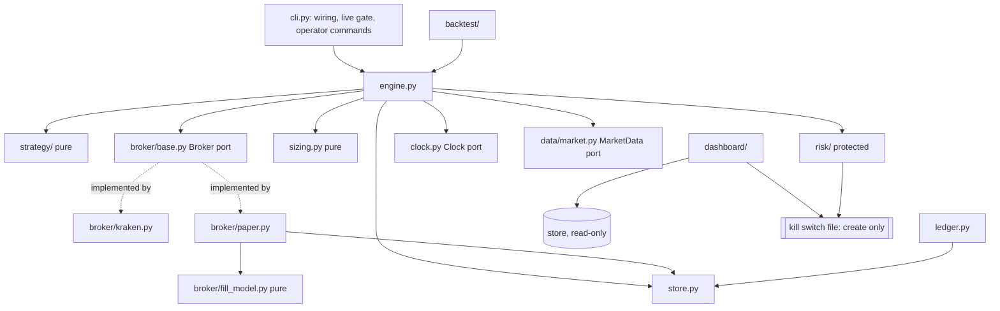
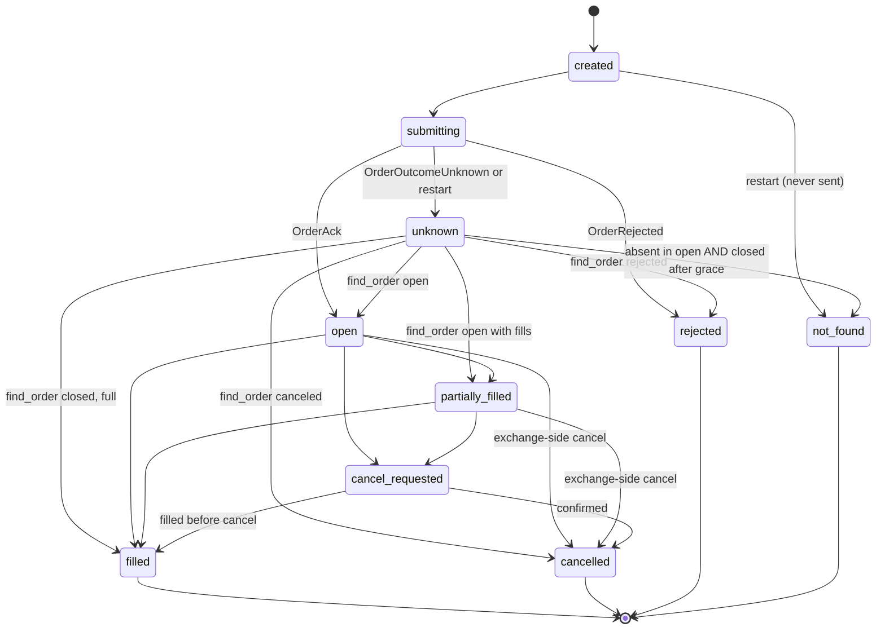
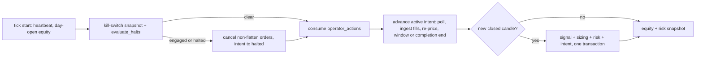

# Architecture spine: trading-bot v1

Produced headless on 2026-11-11 while the operator was unavailable. **[ADOPTED]** marks a decision already in the PROGRESS.md decisions log. Everything else is a proposal for the operator to accept or change. **[ASSUMPTION]** marks an inference. Items that need the operator are under [Open questions](#open-questions). The run's working memory is `docs/planning/architecture.memlog.md`.

Reading order: §1 Broker port and §2 State store come first, as brief §14 asks. Then §3 Invariants (AD-1 to AD-30), then conventions, seed, map, deferred items and open questions.

## Design paradigm

**Hexagonal (ports and adapters) with a functional core.**

- **Functional core (pure: no I/O, no clock):** `strategy/`, `risk/checks.py`, `sizing.py`, `broker/fill_model.py`, `backtest/metrics.py`.
- **Ports:** `Broker`, `Clock`, `MarketData`, `Store`.
- **Adapters:**
  - Broker: `KrakenBroker`, `PaperBroker`, and `FakeBroker` (tests only).
  - Clock: `SystemClock`, `SimClock`, `FakeClock`.
  - MarketData: `CcxtMarketData`, `ReplayMarketData`.
  - Store: `SqliteStore`, either a file or `:memory:`.
- **Application service:** `engine.py` is the only module that composes ports and core. `cli.py` chooses the adapters once and wires them into the engine.



**Dependency rule:** arrows point downward only.
- `strategy/` and `risk/` import nothing from `broker/`, `engine.py`, `store.py`, `data/` or any network library.
- `dashboard/` imports only the read helpers in `store.py`, plus `config.py`, `ledger.py` and `risk/kill_switch.py`.
- An AST import-graph test (`tests/test_architecture.py`) enforces both rules.

## 1. Broker port (defined first)

Signatures only. Money and quantities are `Decimal`. Datetimes are timezone-aware UTC.

```python
# bot/broker/base.py
class Broker(Protocol):
    name: str                                    # "kraken" | "paper" | "fake"
    def load_market(self, pair: str) -> MarketRules: ...
    def get_fee_rates(self, pair: str) -> FeeRates: ...
    def get_balance(self) -> dict[str, Balance]: ...
    def get_ticker(self, pair: str) -> Ticker: ...
    def place_order(self, req: OrderRequest, decision: RiskDecision) -> OrderAck: ...
    def cancel_order(self, pair: str, cl_ord_id: str) -> CancelAck: ...
    def get_open_orders(self, pair: str) -> list[OrderStatus]: ...
    def find_order(self, pair: str, cl_ord_id: str) -> OrderStatus | None: ...   # open AND closed
    def get_fills(self, pair: str, since: datetime) -> list[Fill]: ...
    def check_key_permissions(self) -> KeyPermissions: ...

@dataclass(frozen=True)
class MarketRules:   pair: str; base: str; quote: str; amount_min: Decimal; cost_min: Decimal
                     tick_size: Decimal; amount_step: Decimal; status: str        # "online", "post_only", "cancel_only", ...
@dataclass(frozen=True)
class FeeRates:      maker: Decimal; taker: Decimal; source: Literal["fetch_trading_fee","config"]
@dataclass(frozen=True)
class Balance:       asset: str; free: Decimal; locked: Decimal
@dataclass(frozen=True)
class Ticker:        pair: str; bid: Decimal; ask: Decimal; last: Decimal; ts: datetime
@dataclass(frozen=True)
class OrderRequest:  pair: str; side: Literal["buy","sell"]; qty: Decimal; limit_price: Decimal
                     cl_ord_id: str                                               # always limit + post-only + fee in quote
@dataclass(frozen=True)
class OrderAck:      cl_ord_id: str; exchange_order_id: str; accepted_at: datetime
@dataclass(frozen=True)
class CancelAck:     cl_ord_id: str; already_closed: bool
@dataclass(frozen=True)
class OrderStatus:   cl_ord_id: str; exchange_order_id: str; state: Literal["open","closed","canceled","rejected"]
                     qty: Decimal; filled_qty: Decimal; avg_price: Decimal | None; updated_at: datetime
@dataclass(frozen=True)
class Fill:          exchange_trade_id: str; exchange_order_id: str; cl_ord_id: str | None; pair: str
                     side: str; qty: Decimal; price: Decimal; fee: Decimal; fee_ccy: str
                     liquidity: Literal["maker","taker"]; ts: datetime
@dataclass(frozen=True)
class KeyPermissions: applicable: bool; permissions: frozenset[str]; ip_allowlist: tuple[str, ...]

# Error taxonomy: every adapter maps its native errors to exactly these.
class BrokerError(Exception): ...
class OrderRejected(BrokerError):        reason: str    # definitive: nothing exists on the exchange
class PostOnlyWouldCross(OrderRejected): ...            # triggers a re-price
class OrderOutcomeUnknown(BrokerError): ...             # timeout/network after send: order MAY exist
class RateLimited(BrokerError):          retry_after_s: float
class TransientReadError(BrokerError): ...              # read failed; safe to retry
class FatalBrokerError(BrokerError): ...                # auth, permission, nonce: engine halts
```

**Methods added to the brief's six:**
- `find_order`: the duplicate-prevention lookup. Kraken dedups `cl_ord_id` only among open orders **[ADOPTED]**.
- `load_market` and `get_fee_rates`: minimums and fees come from the exchange (CON-03).
- `check_key_permissions`: SAF-07 **[ADOPTED]**.

`place_order` takes the `RiskDecision`. Every adapter raises unless `decision.approved` is true and `decision.cl_ord_id == req.cl_ord_id` (AD-10).

**Adapters:**

- **KrakenBroker** wraps `ccxt.kraken` with `enableRateLimit=True` and `verbose=False`.
  - Its constructor requires a `LiveGate` token (AD-15).
  - Every order, buys and sells alike, is sent with `clientOrderId=cl_ord_id`, `postOnly=True` and `oflags='fciq'`. ccxt merges these into `oflags=fciq,post` (checked against ccxt master on 2026-11-11). The order is post-only and the fee is charged in EUR. Kraken's default on sells is a fee in base currency (`fcib`), which would stop the bot selling its full base balance **[ADOPTED, pair research §6]**. `fciq` is only a preference, so AD-27 halts if a fill arrives with its fee in another currency. A unit test checks the outgoing request parameters.
  - `find_order` queries OpenOrders, then ClosedOrders, filtered by `cl_ord_id`.
  - `get_fee_rates` uses `fetch_trading_fee` only, and fails closed **[ADOPTED]**.
  - `check_key_permissions` calls `privatePostGetApiKeyInfo` and parses both snake_case and camelCase **[ADOPTED]**.
  - **Post-only crossing:** ccxt has no specific mapping for it, and Kraken may either return an error or accept the order and then cancel it. Both cases map to `PostOnlyWouldCross`:
    - a synchronous error whose text contains "post only";
    - an acknowledged order that `find_order` reports as canceled, with 0 filled and a post-only reason.

    At M6, place one minimum-size crossing order to record the real response, and save it as a test fixture (WR-04).
  - `EOrder:Cost minimum not met`, `EOrder:Order minimum not met` and `EOrder:Tick size check failed` map explicitly to `OrderRejected`.
  - `find_order` and `cancel_order` by `clientOrderId` are verified: ccxt sends it as `cl_ord_id`, and the Kraken OpenOrders and ClosedOrders endpoints document filtering on that field.
  - GetApiKeyInfo reference: https://docs.kraken.com/api-reference/account-data/get-api-key-info
- **PaperBroker** is used in both dry-run and backtest.
  - It receives the engine's `Store` instance by injection. It never opens its own connection.
  - It keeps a virtual account in the `paper_*` tables and fills through `fill_model.py` (AD-6).
  - It initialises from `paper.initial_quote` in config on first start.
- **FakeBroker** is for tests only. It is scriptable and can inject partial fills, a timeout after acceptance, rejects, rate limits, late fills, an exchange-side cancel and unknown fills.

## 2. State store (defined first)

The store is SQLite through stdlib `sqlite3`, with one database file per (mode, strategy).
- **Connection settings:** read-write connections set `PRAGMA journal_mode=WAL; synchronous=FULL; foreign_keys=ON; busy_timeout=5000`. Read-only connections (the dashboard) set only `busy_timeout`. `var/state/` must stay writable, because a read-only WAL reader may need to create `-wal` and `-shm` files.
- **Transactions:** every state change is a single transaction, committed **before** the external call it describes (AD-7).
- **Migrations:** numbered SQL files, applied at startup. `schema_meta.schema_version` must match the code.
- **Backups:** the engine runs a daily `sqlite3.Connection.backup()` to `var/backups/`, keeping 30 copies. The store holds the only full copy of the tax ledger.

DDL conventions:
- `*_at` columns are ISO-8601 UTC TEXT (`2026-11-11T00:00:00.000Z`).
- Money, quantities and equity are decimal TEXT.
- `REAL` is used only for analytics columns that are never compared against a limit or reconciled.

```sql
CREATE TABLE schema_meta (key TEXT PRIMARY KEY, value TEXT NOT NULL);
-- write-once keys: schema_version, mode, strategy_id, exchange, pair, quote_ccy,
--   initial_quote, initial_base, initial_at   (set by engine on first start from get_balance(); never updated)

CREATE TABLE runs (
  run_id INTEGER PRIMARY KEY, started_at TEXT NOT NULL, stopped_at TEXT,
  mode TEXT NOT NULL CHECK (mode IN ('backtest','dry-run','live')),
  strategy_id TEXT NOT NULL, git_commit TEXT NOT NULL, git_dirty INTEGER NOT NULL,
  config_hash TEXT NOT NULL, limits_hash TEXT NOT NULL, pid INTEGER NOT NULL, stop_reason TEXT
);

CREATE TABLE heartbeats (
  run_id INTEGER NOT NULL REFERENCES runs, at TEXT NOT NULL, loop_state TEXT NOT NULL,
  PRIMARY KEY (run_id, at)
);

CREATE TABLE signals (                      -- the journal: one row per evaluated closed candle
  signal_id TEXT PRIMARY KEY,               -- '{strategy_id}|{pair}|{timeframe}|{candle_open_at}'
  run_id INTEGER NOT NULL REFERENCES runs,
  strategy_id TEXT NOT NULL, pair TEXT NOT NULL, timeframe TEXT NOT NULL,
  candle_open_at TEXT NOT NULL, evaluated_at TEXT NOT NULL,
  target_fraction TEXT NOT NULL, signal_price TEXT NOT NULL, indicators_json TEXT NOT NULL,
  outcome TEXT NOT NULL CHECK (outcome IN ('pending','no_action','filled','partially_filled',
          'not_filled','rejected_by_risk','skipped_by_operator','below_minimum','halted','dust')),
  outcome_reason TEXT,
  UNIQUE (strategy_id, pair, timeframe, candle_open_at)
);

CREATE TABLE intents (                      -- one order decision; at most one per signal
  intent_id INTEGER PRIMARY KEY,
  signal_id TEXT UNIQUE REFERENCES signals,
  source_action_id INTEGER UNIQUE REFERENCES operator_actions,   -- set for flatten
  is_flatten INTEGER NOT NULL DEFAULT 0,
  pair TEXT NOT NULL, side TEXT NOT NULL CHECK (side IN ('buy','sell')),
  reference_price TEXT NOT NULL,            -- signal close, or mid when flatten created (price-sanity base)
  target_qty TEXT NOT NULL, filled_qty TEXT NOT NULL DEFAULT '0',   -- filled_qty = sum(fills) (AD-27)
  state TEXT NOT NULL CHECK (state IN ('awaiting_approval','working','completing','done',
          'expired','cancelled','halted')),
  approval_mode TEXT NOT NULL CHECK (approval_mode IN ('manual','autonomous')),
  approval_deadline_at TEXT, window_end_at TEXT NOT NULL, completion_end_at TEXT,
  created_at TEXT NOT NULL, updated_at TEXT NOT NULL,
  CHECK ((is_flatten = 0 AND signal_id IS NOT NULL AND source_action_id IS NULL)
      OR (is_flatten = 1 AND signal_id IS NULL AND source_action_id IS NOT NULL))
);
CREATE UNIQUE INDEX one_active_intent_per_pair ON intents(pair)
  WHERE state IN ('awaiting_approval','working','completing');

CREATE TABLE orders (                       -- one row per submission attempt
  order_id INTEGER PRIMARY KEY,
  intent_id INTEGER NOT NULL REFERENCES intents, attempt_no INTEGER NOT NULL,
  cl_ord_id TEXT NOT NULL UNIQUE,           -- uuid4 hex; inserted only after risk approval, BEFORE send
  exchange_order_id TEXT UNIQUE,
  side TEXT NOT NULL, limit_price TEXT NOT NULL, qty TEXT NOT NULL,
  filled_qty TEXT NOT NULL DEFAULT '0', avg_price TEXT,
  state TEXT NOT NULL CHECK (state IN ('created','submitting','open','partially_filled','filled',
          'cancel_requested','cancelled','rejected','unknown','not_found')),
  reject_reason TEXT,
  created_at TEXT NOT NULL, submitted_at TEXT, accepted_at TEXT, last_checked_at TEXT, closed_at TEXT,
  UNIQUE (intent_id, attempt_no)
);
CREATE UNIQUE INDEX one_live_order_per_intent ON orders(intent_id)
  WHERE state IN ('created','submitting','open','partially_filled','cancel_requested','unknown');

CREATE TABLE order_events (                 -- append-only transition log
  event_id INTEGER PRIMARY KEY, order_id INTEGER NOT NULL REFERENCES orders,
  at TEXT NOT NULL, from_state TEXT, to_state TEXT NOT NULL, detail_json TEXT NOT NULL
);

CREATE TABLE fills (
  fill_id INTEGER PRIMARY KEY,
  exchange TEXT NOT NULL, exchange_trade_id TEXT NOT NULL,
  order_id INTEGER NOT NULL REFERENCES orders,
  at TEXT NOT NULL, pair TEXT NOT NULL, base TEXT NOT NULL, quote_ccy TEXT NOT NULL,
  side TEXT NOT NULL, qty TEXT NOT NULL, price TEXT NOT NULL,
  fee TEXT NOT NULL, fee_ccy TEXT NOT NULL CHECK (fee_ccy = quote_ccy),
  liquidity TEXT NOT NULL CHECK (liquidity IN ('maker','taker')),
  reference_price TEXT NOT NULL, slippage_bps REAL NOT NULL,
  quote_is_fiat INTEGER NOT NULL, simulated INTEGER NOT NULL,
  UNIQUE (exchange, exchange_trade_id)
);

CREATE TABLE equity_snapshots (
  at TEXT PRIMARY KEY, equity TEXT NOT NULL, cash TEXT NOT NULL, base_qty TEXT NOT NULL,
  mark_price TEXT NOT NULL, buy_hold_equity TEXT NOT NULL, is_day_open INTEGER NOT NULL DEFAULT 0
);
CREATE UNIQUE INDEX one_day_open_per_day ON equity_snapshots(substr(at,1,10)) WHERE is_day_open = 1;

CREATE TABLE equity_baselines (             -- drawdown baseline; latest row is active; append-only
  baseline_id INTEGER PRIMARY KEY, at TEXT NOT NULL, equity TEXT NOT NULL,
  reason TEXT NOT NULL, action_id INTEGER REFERENCES operator_actions   -- NULL for the first row
);

CREATE TABLE risk_snapshots (               -- per-tick RiskContext + usage, for the dashboard
  at TEXT PRIMARY KEY, context_json TEXT NOT NULL, usage_json TEXT NOT NULL
);

CREATE TABLE risk_events (
  event_id INTEGER PRIMARY KEY, at TEXT NOT NULL,
  kind TEXT NOT NULL CHECK (kind IN ('rejection','halt','halt_reset','kill_on','kill_off',
         'reconcile_mismatch','permission_refusal','stale_data','dust','exchange_reject')),
  rule TEXT NOT NULL, intent_id INTEGER REFERENCES intents,
  reason TEXT NOT NULL, detail_json TEXT NOT NULL
);

CREATE TABLE halts (
  halt_id INTEGER PRIMARY KEY,
  rule TEXT NOT NULL,                       -- daily_loss | total_drawdown | reconcile_mismatch | fatal_error
  triggered_at TEXT NOT NULL, reason TEXT NOT NULL,
  reset_at TEXT, reset_action_id INTEGER REFERENCES operator_actions
);
CREATE UNIQUE INDEX one_active_halt_per_rule ON halts(rule) WHERE reset_at IS NULL;
-- insert with ON CONFLICT DO NOTHING; a risk_events row is written every time

CREATE TABLE operator_actions (             -- the ONLY table the CLI writes; engine consumes
  action_id INTEGER PRIMARY KEY, at TEXT NOT NULL,
  kind TEXT NOT NULL CHECK (kind IN ('approve','reject','reset_halt','flatten','kill_on','kill_off')),
  target_id TEXT, note TEXT NOT NULL, rebase_baseline INTEGER NOT NULL DEFAULT 0,
  consumed_at TEXT, result TEXT
);

CREATE TABLE errors (
  error_id INTEGER PRIMARY KEY, at TEXT NOT NULL, component TEXT NOT NULL,
  error_type TEXT NOT NULL, message TEXT NOT NULL, traceback TEXT     -- redacted before insert
);

CREATE TABLE api_calls (                    -- health; pruned to 30 days
  at TEXT NOT NULL, endpoint TEXT NOT NULL, latency_ms INTEGER NOT NULL,
  ok INTEGER NOT NULL, rate_limited INTEGER NOT NULL
);

-- Owned by `bot review` only (AD-20)
CREATE TABLE signal_counterfactuals (
  signal_id TEXT PRIMARY KEY REFERENCES signals, counterfactual_return TEXT NOT NULL,
  computed_at TEXT NOT NULL, data_hash TEXT NOT NULL
);
CREATE TABLE backtest_predictions (
  signal_id TEXT PRIMARY KEY REFERENCES signals, backtest_run_ref TEXT NOT NULL,
  predicted_fill_price TEXT, predicted_fill_at TEXT, predicted_equity TEXT NOT NULL,
  computed_at TEXT NOT NULL, data_hash TEXT NOT NULL
);
CREATE TABLE weekly_reviews (
  week_start TEXT PRIMARY KEY, computed_at TEXT NOT NULL, backtest_run_ref TEXT NOT NULL,
  trades_closed INTEGER NOT NULL, avg_trade_realized TEXT, avg_trade_expected TEXT,
  equity_diff_pp TEXT, max_fill_diff_pct TEXT,
  flag TEXT NOT NULL CHECK (flag IN ('ok','insufficient_trades','decaying','no_edge_baseline')),
  note TEXT
);

-- Owned by broker/paper.py only
CREATE TABLE paper_balances (asset TEXT PRIMARY KEY, free TEXT NOT NULL, locked TEXT NOT NULL);
CREATE TABLE paper_orders (
  exchange_order_id TEXT PRIMARY KEY, cl_ord_id TEXT NOT NULL UNIQUE, pair TEXT NOT NULL, side TEXT NOT NULL,
  qty TEXT NOT NULL, limit_price TEXT NOT NULL, filled_qty TEXT NOT NULL, state TEXT NOT NULL,
  accepted_at TEXT NOT NULL, closed_at TEXT
);
CREATE TABLE paper_fills (
  exchange_trade_id TEXT PRIMARY KEY, exchange_order_id TEXT NOT NULL REFERENCES paper_orders,
  at TEXT NOT NULL, qty TEXT NOT NULL, price TEXT NOT NULL, fee TEXT NOT NULL, fee_ccy TEXT NOT NULL
);

CREATE VIEW ledger AS                       -- tax ledger (CON-09, CON-10): a view, never a copy
  SELECT f.at, f.pair, f.base, f.quote_ccy, f.side, f.qty, f.price,
         f.fee, f.fee_ccy, f.simulated, f.exchange_trade_id,
         (f.side = 'sell' AND f.quote_is_fiat = 1) AS is_crypto_to_fiat_disposal
  FROM fills f ORDER BY f.at;
```

**Idempotency keys:**

| Effect | Key | Guarantee |
|---|---|---|
| Evaluate a candle | `signals.signal_id` UNIQUE | A restart never re-journals a candle |
| Decide to trade | `intents.signal_id` / `source_action_id` UNIQUE, `one_active_intent_per_pair` | One decision per signal or action, and never two active at once |
| Send to the exchange | `orders.cl_ord_id` UNIQUE, committed before send, plus `one_live_order_per_intent` | No resend without a lookup (AD-8) |
| Ingest a fill | `fills(exchange, exchange_trade_id)` UNIQUE | Re-polling never double-counts |
| Halt | `one_active_halt_per_rule` | A halt stays until a reset action |
| Day-open equity | `one_day_open_per_day` | One reference per UTC day |
| Operator command | `operator_actions.consumed_at` | Each command is applied once |

**Derived quantities** (helpers in `store.py`, used by the engine, risk context, review and dashboard alike):
- base position = `initial_base` + Σ buy qty − Σ sell qty
- cash = `initial_quote` − Σ (buy qty × price + fee) + Σ (sell qty × price − fee)
- `equity_at(t)` = cash + base × mark

None of these is stored as a mutable balance.

## 3. Invariants and rules

### AD-1: The same engine in every mode; only the adapters change [ADOPTED, brief §5]

- **Binds:** engine.py, backtest/, cli.py
- **Prevents:** a separate backtest order path.
- **Rule:**
  - Backtest = `Engine(PaperBroker, SimClock, ReplayMarketData, SqliteStore(":memory:"))`. The backtest forces `approval=autonomous`. A halt ends the backtest run, and the report shows it.
  - Dry-run = `Engine(PaperBroker, SystemClock, CcxtMarketData, SqliteStore(file))`.
  - Live = `Engine(KrakenBroker, SystemClock, CcxtMarketData, SqliteStore(file))`.
  - `engine.py` has no `if mode` branch except for labelling.

### AD-2: Clock port

- **Binds:** all code that reads time
- **Prevents:** hidden calls to `now()` that make results non-reproducible.
- **Rule:**
  - Interface: `class Clock(Protocol): def now(self) -> datetime; def sleep_until(self, t: datetime) -> None`.
  - Only `clock.py` may call `datetime.now`, `datetime.utcnow`, `date.today`, `time.time`, `time.time_ns`, `time.sleep` or `pd.Timestamp.now`. This is enforced by ruff banned-api (TID251, with a per-file ignore for `bot/clock.py`) plus the architecture test.
  - `SimClock` is advanced by the backtester to each tick, using the same `engine.tick_seconds` as live, so order-placement lag is the same. `FakeClock.advance()` is for tests.
  - `SystemClock` compares itself with Kraken's public server time at startup and every hour, and refuses to trade if the skew is more than 5 s.

### AD-3: The strategy is pure and sees only the past

- **Binds:** strategy/
- **Prevents:** a strategy reading the broker, the clock, the network or the future.
- **Rule:**
  - Interface: `class Strategy(Protocol): id: str; timeframe: str; warmup: int; allowed_modes: frozenset[Mode]; def on_candle(self, history: CandleHistory) -> TargetPosition; def indicators(self, history: CandleHistory) -> dict[str, float]`.
  - `CandleHistory` is an immutable view of **closed** candles only, meaning `open_at + interval <= clock.now()`. It is a read-only copy.
  - `TargetPosition` is a `Decimal` in [0, 1].
  - Strategies are built only by `strategy.registry.build(id, params)`, and params are frozen config.

### AD-4: Look-ahead guard (FR-22)

- **Binds:** backtest/lookahead.py
- **Prevents:** future data reaching any decision, by any path.
- **Rule:** prefix-invariance. Every backtest re-runs **the whole pipeline**: a fresh dataset load, a fresh strategy built from the registry, and a fresh engine.
  - It does this on `N = backtest.lookahead_cutpoints` (default 12) seeded cutpoints k.
  - In each re-run, every candle after k is replaced by a seeded random walk.
  - The target positions for candles ≤ k must equal the baseline run's. Otherwise `LookAheadError` is raised and no report is written.
  - Because data enters only through the dataset loader, a closure, a global or a precomputed column cannot escape the check.
  - `tests/test_lookahead.py` plants a strategy that reads t+1 through a module-level reference to the loaded frame, and asserts the error.

### AD-5: Execution model [ADOPTED: post-only limit, re-price, cancel and skip]

- **Binds:** engine.py, broker/, backtest/
- **Prevents:** live, paper and backtest executing differently, and taker fees.
- **Rule:**
  - **Window.** A signal on candle t opens an execution window `[t_close, t_close + execution.window]`. Config validation requires `window ≤ timeframe`.
  - **Pricing.** The engine places a post-only limit at the best bid (buy) or best ask (sell), rounded to `tick_size` in the passive direction.
  - **Re-pricing.** Every `execution.reprice_interval_minutes` (30 min), if the order is unfilled or partly filled, the engine:
    1. requests a cancel and waits until it is confirmed and all of the order's fills are ingested (AD-27);
    2. recomputes the quantity (AD-13);
    3. places a new order at the current best price with a new `cl_ord_id`.

    An intent makes at most `execution.max_submissions_per_intent` (12) exchange submissions, the first order included. Independently, the protected `risk.max_exchange_submissions_per_day` (24) caps all submissions per UTC day. Config validation requires the per-intent cap ≤ the daily cap. *(M0 deviation from the original AD-10, which put a `max_reprices` value in `risk:`; agreed 2026-11-11, see PROGRESS.md.)*
  - **Rejections.** `PostOnlyWouldCross` triggers an immediate re-price, which counts toward the maximum. Any other `OrderRejected` ends the intent (AD-28) with a risk event of kind `exchange_reject`.
  - **Window end** follows AD-28, including the buy completion phase.
  - v1 code has no market orders. The backtest also reports a taker variant (fill at the t+1 open, with the taker fee) for CON-06.

### AD-6: One fill model for backtest and paper (FR-24, FR-60)

- **Binds:** broker/fill_model.py, broker/paper.py, backtest/
- **Prevents:** two simulators that cannot agree.
- **Rule:**
  - `fill_model.simulate(order, exec_candle, rules, fees, slippage_bps) -> SimFill | None` is pure.
  - **Eligible candles:** only **closed** execution candles (`execution.sim_timeframe`, default 15m) with `open_at ≥ order.accepted_at` rounded **up** to the candle boundary. A candle that began before the order existed can never fill it.
  - **Fill rule:** a buy at limit L fills in full at L when the candle's `low < L` (strict trade-through). A sell fills when `high > L`. The fee is maker, and `slippage_bps` is applied against the trader.
  - PaperBroker evaluates fills when the engine polls (`get_open_orders`/`find_order`/`get_fills`).
  - **Candle sources:** in dry-run, closed live execution candles come from ccxt. In backtest, the same timeframe comes from the Parquet cache.
  - **Bid/ask:** in backtest, bid/ask = execution candle open ± `execution.sim_half_spread_bps`. This is the only modelled divergence, and GL-02 measures it.
  - **Consistency test:** dry-run records each bid/ask it priced from (`api_calls` detail). The test replays the same recorded candles **and** recorded bid/ask through both paths, and asserts identical trades.

### AD-7: Persist before acting

- **Binds:** engine.py, store.py
- **Prevents:** an exchange order that the store doesn't know about.
- **Rule:**
  1. Generate `cl_ord_id` in memory.
  2. Call `risk.check_order` (and `risk_events` on rejection).
  3. Only if approved, commit the `orders` row as `created`.
  4. Commit `submitting`.
  5. Call `place_order`.
  6. Commit the result.

  Cancels commit `cancel_requested` before the call. No broker call that changes state happens outside this pattern.

### AD-8: Order state machine and duplicate prevention [ADOPTED: look up open and closed orders]

- **Binds:** engine.py (may be split into `engine_orders.py`), broker/
- **Prevents:** duplicates after a timeout or restart, and lost fills.
- **Rule:** any transition not listed below raises `IllegalTransition`, which halts with rule `fatal_error`. Fills may be ingested in any non-terminal state.



- **Unknown orders:** an `unknown` order is never resent. `find_order` is called every 10 s until `execution.unknown_grace` (default 60 s) has passed. Only `not_found` frees the intent for another attempt, which gets a new `cl_ord_id`.
- **Restart mid-order.** Startup order (also used after a crash):
  1. Acquire the lock (AD-17).
  2. Consume pending `reset_halt` actions.
  3. Mark `created` orders as `not_found`.
  4. Treat `submitting` orders as `unknown`.
  5. Resolve every open-like order with `find_order`.
  6. Ingest fills since the oldest open-like order.
  7. Resume pending signals (AD-28).
  8. Reconcile (AD-9).
  9. Continue each intent if its window or completion phase is still open, otherwise end it (AD-28).
- **Timeouts:**
  - A read is retried with backoff, up to 3 times, then logged with no change of state.
  - `place_order` goes to `unknown`.
  - `cancel_order` stays in `cancel_requested` and is re-checked with `find_order` on the next tick.
- **Rate limits:** `RateLimited` sleeps for `retry_after_s`, is recorded in `api_calls`, and never changes state.

### AD-9: Reconciliation halts on mismatch [ADOPTED, brief §5.4]

- **Binds:** engine.py, in dry-run and live (not backtest)
- **Prevents:** trading on a wrong view of positions or orders.
- **Rule:**
  - **When:** at startup (step 8 of AD-8), and every hour while running.
  - **Open orders:** exchange open orders on the pair must equal the store's open-like orders, matched by `cl_ord_id`. An order the bot did not create is a mismatch.
  - **Base balance:** the exchange's base balance (free + locked) must **exactly** equal the derived base position.
  - **Quote balance:** the exchange's EUR balance must be ≥ the derived cash **[ASSUMPTION A-1]**.
  - **Fills:** every exchange fill must match a store order. An unmatched fill is a mismatch, and is never dropped.
  - **On a mismatch:** write `risk_events`, insert a `halts(rule='reconcile_mismatch')` row, log both sides, cancel the bot's own known resting orders (best effort), and exit non-zero.
  - In dry-run, the comparison is engine tables against the `paper_*` tables.

### AD-10: Risk module boundary [ADOPTED, SAF-04, SAF-05]

- **Binds:** risk/, config.py, engine.py
- **Prevents:** any path that writes limits or bypasses checks.
- **Rule:**
  - **What `risk/` exposes:**
    - `RiskLimits`: a frozen pydantic model.
    - `check_order(p: ProposedOrder, ctx: RiskContext, limits) -> RiskDecision`: pure.
    - `evaluate_halts(ctx, limits) -> list[HaltTrigger]`: pure.
    - `kill_switch_engaged(path) -> bool`: reads only.
  - `ProposedOrder` carries `intent_id`, `attempt_no`, `is_flatten`, `side`, `qty`, `limit_price` and `cl_ord_id`.
  - `RiskContext` is assembled by the engine from the store helpers. It contains: equity now, day-open equity, active baseline, intents created today, last closed candle time and its synthetic flag, ticker time, `reference_price`, current mid, signed position plus resting quantity, active halts, and the kill switch state.
  - **Loading:** limits are loaded once at startup from the `risk:` section of `config.yaml`, opened read-only. That section also holds the kill-switch path (resolved to an absolute path at load) and the daily cap `max_exchange_submissions_per_day`. The per-intent cap `max_submissions_per_intent` lives in `execution:`, not `risk:` (M0 deviation, see AD-5 and PROGRESS.md). Limits are hashed into `runs.limits_hash`, printed in the live banner and written to `risk_snapshots`, and are never reloaded.
  - **No write path:** an AST test fails if any module opens the config path for write or append, or calls `write_text` or a yaml dump on it.
  - **Every submission is checked,** re-prices and flattens included. The adapter enforces the `RiskDecision` (§1).
  - `risk/` and `tests/risk/` stay small and separate, so that protected commits (SAF-04) touch nothing else.

### AD-11: Risk rules and their exact semantics [values ADOPTED from PROGRESS]

- **Binds:** risk/checks.py, risk/halts.py
- **Prevents:** the builder, the tests and the dashboard reading the limits differently.
- **Rule:**

| Rule | Check | Value | Flatten |
|---|---|---|---|
| max_position | Signed: only when the order **increases** exposure. (position + resting buys + qty) × price ≤ min(fraction × equity, absolute) | 100%, €25 | n/a (sell) |
| max_orders_per_day | Only when `attempt_no == 1`: count of intents with `created_at` on the UTC day, excluding this one, < limit **[ASSUMPTION A-4, Q-8]** | 4 | exempt |
| daily_loss | equity ≤ (1 − x) × day-open equity → **halt** | 10% | n/a |
| total_drawdown | equity ≤ (1 − x) × active `equity_baselines` row → **halt** | 25% | n/a |
| stale_candle | latest closed candle older than 2 intervals, or synthetic → reject | 2 intervals | exempt |
| stale_ticker | ticker `ts` older than the threshold → reject | 120 s | applies |
| price_sanity | abs(mid − `reference_price`) / `reference_price` > x → reject | 2% | applies (reference = mid at creation) |
| kill_switch / halt | kill-switch file exists, or any active halt → reject | path in `risk:` | exempt |
| market_status | `MarketRules.status` ≠ `online` → reject | n/a | applies |
| minimums | AD-13 | metadata | applies |

- **Day-open equity:** the first tick with `at ≥ 00:00 UTC` writes it, before any risk check. It is the derived position marked at the open of the day's first execution candle.
- **Start baseline:** the first `equity_baselines` row is `initial_quote + initial_base × mark` at first start.
- **Equity** is marked at the ticker mid.
- **Rejections:** every rejection writes `risk_events`. If the intent ends because of it, the outcome follows AD-28.

### AD-12: Halt and kill-switch behaviour

- **Binds:** engine.py, risk/, cli.py, dashboard/
- **Prevents:** a resting order filling after a stop (BI-06), and the bot selling into a crash on its own.
- **Rule:**
  - **In order:** each tick first snapshots the kill switch and evaluates halts (`evaluate_halts`), **before** any submission. The kill-switch file is re-read just before every `place_order`.
  - **When engaged or halted**, the engine:
    1. blocks new intents and submissions;
    2. cancels every resting non-flatten order on the pair in the same tick, and ingests the final fills;
    3. moves the active non-flatten intent to `halted` (outcome `halted`, AD-28);
    4. **keeps the position**, with no automatic sell;
    5. writes `risk_events`.
  - **Why keep the position:** a forced exit chases a falling market and pays fees, and exposure is capped at €25. A halt means the system or strategy is not trusted, so the decision to exit belongs to the operator.
  - **Why cancel orders:** a resting buy filling after a halt increases exposure. One rule (cancel everything) is the simplest to audit.
  - **Flatten:** `bot flatten --note` is the only way to sell while halted or killed. It is a risk-reducing exit, exempt as shown in AD-11, and it follows AD-25.
  - **Kill switch, engage:**
    - The dashboard (Risk page, with confirmation) or `bot kill on --note` creates the file at the absolute `risk.kill_switch_path`.
    - The file content is one line: `source=<dashboard|cli|file> at=<UTC>`. The dashboard writes it through `risk.kill_switch.engage(path, source)`, and **cannot delete** it **[ADOPTED, UX spec]**.
    - A file created by hand counts too, with `source=file` if it has no content.
  - **Kill switch, disengage:** CLI only, `bot kill off --note`. It writes an `operator_actions` row, and the engine deletes the file when it consumes the action. The engine is the only deleter.
  - The engine logs `kill_on`/`kill_off` only when the observed state differs from the last state it logged.
  - **Halt reset:** CLI only, `bot reset-halt <rule> --note` **[ADOPTED]**. For `total_drawdown`, `--rebase-baseline` appends a new `equity_baselines` row (Q-6). Halts never expire on a timer.

### AD-13: Sizing, minimums and dust [ADOPTED: read from metadata; reject, never round up]

- **Binds:** sizing.py, risk/checks.py, engine.py
- **Prevents:** unsellable remainders (BI-08), insufficient-funds rejects, and silent rounding.
- **Rule:**
  - `MarketRules` is loaded at startup and again when each intent is created, because minimums change with no notice **[ADOPTED, pair research]**.
  - `sizing.order_qty(target, ctx, rules, fees, limit_price) -> Decimal | NoOrder(reason)` is recomputed at **every** submission:
    - buy qty = floor_step( (min(target × equity, max_position caps) − current exposure) and free EUR / (1 + maker fee), whichever is smaller, divided by `limit_price` )
    - sell qty = the full derived base position (target 0).
  - **Sellable threshold:** a buy is allowed only if the position *after* it, `P`, satisfies `P ≥ amount_min` and `P × price × (1 − total_drawdown) ≥ cost_min`, so it stays sellable after the worst loss the limits allow. Otherwise the outcome is `below_minimum`.
  - **Buy partial-fill remainder:** handled by the completion phase (AD-28).
  - **Sell-side dust:** a sell that ends with base below `amount_min` writes a `dust` risk event, and the dust stays in equity. The next buy adds to it, and the next full-balance sell clears it. No top-up buy is made just to sell.
  - With fees in EUR (`fciq`), the base position equals the filled quantity.

### AD-14: Key permissions [ADOPTED: GetApiKeyInfo, fail closed]

- **Binds:** broker/kraken.py, cli.py
- **Prevents:** running with a key that can withdraw.
- **Rule:**
  - **When:** in live, before any other private call.
  - **Refuse** (and write `permission_refusal`, exit non-zero) if:
    - the call or parse fails;
    - `withdraw-funds`, `add-withdraw-address` or `update-withdraw-address` is present;
    - any of `query-funds`, `query-open-trades`, `query-closed-trades`, `modify-trades` or `close-trades` is missing.
  - **Print** `ip_allowlist`, or "NOT RESTRICTED" when empty (the SAF-03 reminder).

### AD-15: Live double gate; plumbing structurally impossible in live [ADOPTED SAF-09, FR-10]

- **Binds:** cli.py, broker/kraken.py, strategy/registry.py
- **Prevents:** going live by accident, and live plumbing trades.
- **Rule:** `LiveGate` can be created only by `cli.open_live_gate(args, env, strategy, settings)`. It requires every one of:
  - the `bot live --live` flag;
  - env var `TRADING_BOT_LIVE=I_ACCEPT_REAL_ORDERS`;
  - `strategy.id` is in the frozen `LIVE_STRATEGIES` mapping (`v0_trend` only; `plumbing` exists only in `DRY_RUN_STRATEGIES`);
  - `"live"` is in `strategy.allowed_modes`;
  - the timeframe is 4h or 1d (CON-08);
  - `execution.approval` is set explicitly;
  - live fees from `fetch_trading_fee` equal config `fees` (Conventions);
  - AD-14 passes.

  If any is missing, the bot exits with code 2 and names the condition. `KrakenBroker.__init__` requires the token. The banner shows mode, balances, `initial_*`, the active baseline, every limit and `limits_hash`, and is also written to the log. Tests cover each refusal (FR-63).

### AD-16: Approval mode [ADOPTED: both modes; manual by default for the first live weeks]

- **Binds:** engine.py, cli.py
- **Prevents:** a second channel writing into the store, and approvals of stale orders.
- **Rule:**
  - `execution.approval` is `manual` or `autonomous`. In manual mode, an intent starts in `awaiting_approval` with `approval_deadline_at = window_end_at`, and the engine prints and logs the order with the allowed price band (± price_sanity).
  - `bot approve <id>` / `bot reject <id> --note` write `operator_actions`.
  - Approval covers the **intent** (side, quantity rule, window). Re-prices inside the band need no re-approval, but risk checks still run on every submission.
  - Past the deadline, the intent expires, with outcome `skipped_by_operator`.

### AD-17: One writer per table; a read-only dashboard

- **Binds:** store.py, cli.py, dashboard/, review
- **Prevents:** two owners of one entity, and races between processes.
- **Rule:**
  - **Engine:** the only writer of every table except `operator_actions`, `paper_*`, and the review tables.
  - **CLI:** inserts only into `operator_actions`. The engine sets `consumed_at`.
  - **`broker/paper.py`:** owns the `paper_*` tables.
  - **`bot review`:** owns `signal_counterfactuals`, `backtest_predictions` and `weekly_reviews`. It uses its own `review.lock`, so it can run while the engine runs.
  - **Engine lock:** `<store>.lock` is created with O_EXCL and holds the PID, with a stale-PID check. It stops two engines from running on one store.
  - **Dashboard:**
    - It opens the store with `file:{path}?mode=ro`. This works whether or not the engine is running. If the database file is missing, it shows an empty state and never creates the file.
    - It reads `risk_snapshots` for usage and never recomputes risk.
    - Its only write is `kill_switch.engage`.

### AD-18: Data pipeline and no-trade policy [ADOPTED source choice]

- **Binds:** data/
- **Prevents:** silently repaired data, and the "no gaps" rule failing on legitimate no-trade periods.
- **Rule:**
  - **Archive import:** `bot data import-archive --zip <path>` (archive downloaded by hand, outside the repo):
    - verifies the published SHA256;
    - streams only `XBTEUR_{1440,240,15}.csv` (no header, Unix seconds).
  - **Recent data:** `bot data update` uses ccxt `fetch_ohlcv`, which caps at 720 candles.
  - **Overlap check:** where the two sources overlap, OHLC must agree within 1 tick and volume within 1% **[ASSUMPTION A-3]**. Otherwise the import fails.
  - **Cache:** `var/data/BTC-EUR/{timeframe}.parquet`, with columns `open_at` (timestamp[ms, UTC]), `open`, `high`, `low`, `close`, `volume`, `trades`, `source` ∈ {archive, api, synthetic}.
  - **Validation:** fails loudly, never repairs. It checks that timestamps are unique, monotonic, interval-aligned and UTC, and that OHLC is consistent. A missing interval is either:
    - a *no-trade candle*, if it falls inside the archive range;
    - a *download gap*, if it falls inside the API range or between the two sources. Download gaps always fail.
  - **`data.no_trade_policy`:** `fill_flat` (default) or `fail`.
    - `fill_flat` inserts O=H=L=C=previous close with volume 0 and `source=synthetic`.
    - It fails if synthetic candles exceed `data.max_synthetic_ratio` (0.1%) after `data.history_start`.
  - The engine never acts on a synthetic latest candle (stale_candle).

### AD-19: Ledger and disposals [ADOPTED CON-09, CON-10; Europe/Paris tax year]

- **Binds:** ledger.py
- **Prevents:** a tax record that diverges from the fills.
- **Rule:**
  - The ledger is the `ledger` view. `quote_is_fiat` comes from config `fiat_currencies: [EUR]`, so a stablecoin quote is not counted as a disposal (CON-11).
  - `bot ledger export --year Y` writes CSV with columns `at_utc, at_paris, pair, side, qty, price, quote_ccy, gross_quote, fee, fee_ccy, is_crypto_to_fiat_disposal, simulated, exchange_trade_id`.
  - Rows belong to year Y by their **Europe/Paris** local date. Storage stays UTC **[ADOPTED]**.
  - The disposal total is the sum of `gross_quote` over disposal rows. Fees are shown separately (Q-11).
  - Dry-run exports are labelled SIMULATED (NFR-09).

### AD-20: Journal, weekly review, DECAYING

- **Binds:** engine.py, backtest/compare.py, `bot review`
- **Prevents:** realized and expected results compared on different bases.
- **Rule:**
  - **Engine** writes signals and their outcomes (AD-28).
  - **`bot review`** runs weekly or on demand. It reads a hashed snapshot of the Parquet cache and re-runs the backtest over the same period, with the config named by `review.backtest_run_ref`. It writes:
    - `backtest_predictions`;
    - `signal_counterfactuals`: for each untraded signal, the return of the intended trade from the t+1 open to the next signal that changes the target, at maker cost;
    - `weekly_reviews`, with the GL-02 metrics (max per-fill price difference against 0.5%, equity difference against 2 pp) **[ADOPTED]**.
  - **Flag:**
    - `insufficient_trades` when there are fewer than 20 closed round trips;
    - `decaying` when the realized average per trade is below 0.5 × the backtest average, and that average is positive;
    - `no_edge_baseline` when the backtest average is ≤ 0 (Q-3).

### AD-21: Results, change log and holdout registry are committed files

- **Binds:** backtest/, results/, changes.md
- **Prevents:** a second holdout run or a sixth change that the auditor cannot see.
- **Rule:**
  - **Every backtest** writes `results/{date}_{strategy}_{commit}.json`, containing:
    - metrics at maker and at taker rates, plus benchmarks;
    - configurations tried and the bootstrap CI on Sharpe;
    - commit and dirty flag, config hash, data range and data hash;
    - the change number.

    Line 1 of the report is the verdict against buy-and-hold after costs.
  - **Holdout runs:** each appends one line to the committed `results/holdout_runs.jsonl`. A run is refused when the tree is dirty, or when a line already exists for the strategy, unless `--rerun-holdout --reason` is given. That line is marked `rerun: true`, and later reports carry a banner.
  - **Holdout boundary:** walk-forward and parameter search refuse any range that touches `backtest.holdout_start` (Q-2).
  - **Change limit:** `bot backtest --change N` refuses N > 5 per strategy and requires a matching entry in `changes.md`.

### AD-22: Secrets and redaction [ADOPTED SAF-01, SAF-02]

- **Binds:** config.py, logging_setup.py, broker/kraken.py
- **Prevents:** keys reaching logs, tracebacks, the store or git.
- **Rule:**
  - `.env` (gitignored; `.env.example` holds empty values) contains only `TRADING_BOT_SECRETS_FILE=<absolute path>`.
  - `config.load_secrets()`:
    - refuses a path inside the repo;
    - reads the file with `dotenv_values` into a `SecretStr`;
    - never writes it to `os.environ`;
    - hands it only to KrakenBroker.
  - Dry-run and backtest never call `load_secrets()`.
  - A root logging filter redacts secret values and `API-Key`/`API-Sign` patterns. The same function runs on `errors` rows before insert.
  - A test plants fake secrets, raises through the ccxt wrapper, and asserts that they are absent from logs and the store.

### AD-23: Dashboard binding [ADOPTED SAF-15]

- **Binds:** dashboard/, `.streamlit/config.toml`
- **Prevents:** exposure on the LAN.
- **Rule:**
  - `.streamlit/config.toml` sets `server.address = "127.0.0.1"`, `server.headless = true` and `browser.gatherUsageStats = false`.
  - `bot dashboard` passes all three settings as CLI flags too, because Streamlit reads `config.toml` from the current working directory.
  - A test checks both.
  - The views follow `docs/planning/ux-dashboard/` and label DRY-RUN or LIVE from `schema_meta.mode`.

### AD-24: Tests never touch the network

- **Binds:** tests/
- **Prevents:** any test reaching Kraken, public or private (SAF-10, SAF-11). This answers PRD OD-17 as "no network".
- **Rule:**
  - **Network block:** an autouse fixture in `tests/conftest.py` replaces `socket.socket.connect`, `socket.create_connection` and `socket.getaddrinfo` with a raise of `NetworkBlocked`. A self-test proves it.
  - **Test doubles:** KrakenBroker is tested only with an injected fake ccxt object. Data tests use fixtures under `tests/fixtures/`.
  - **Engine tests** use FakeBroker and FakeClock, and cover:
    - restart in every open-like order state, and with `created` or `pending` rows;
    - partial fill → cancel → completion phase;
    - a timeout after acceptance, with no duplicate;
    - `not_found` after the grace period;
    - an exchange-side cancel;
    - an unmatched fill halting;
    - rate limits;
    - stale data;
    - every risk rule (GL-03);
    - the kill switch from file, CLI and the dashboard `engage` (GL-04);
    - flatten while halted;
    - a reconciliation mismatch.
  - **No silent skips:** a test fails if any test is `skip`/`xfail` without a referenced operator decision (FR-64).

### AD-25: Flatten intents

- **Binds:** engine.py, cli.py
- **Prevents:** flatten conflicting with active intents, halts or the journal.
- **Rule:**
  - `bot flatten --note` writes an `operator_actions` row (kind `flatten`). On consuming it, the engine:
    1. cancels and ends any active intent (`cancelled`, outcome `skipped_by_operator`);
    2. creates an intent with `is_flatten=1`, `source_action_id` set, and `reference_price` = the mid at that moment.
  - The window is `execution.window`, and quantity is recomputed (full base) at each submission.
  - New signals while a flatten is active are journaled as `no_action` with reason `flatten_active`.

### AD-26: Account baselines are write-once

- **Binds:** store.py, engine.py, broker/paper.py
- **Prevents:** derived cash being corrupted by a drawdown rebase, and two different seeds for the account.
- **Rule:**
  - The engine writes `schema_meta.initial_quote`, `initial_base` and `initial_at` **once**, from `get_balance()` on first start. For the paper broker, that balance was seeded from `paper.initial_quote`.
  - For live, `initial_quote` = min(EUR balance, `capital.allocated_quote` from config).
  - Derived position and cash use only these values plus fills.
  - The drawdown baseline lives separately in `equity_baselines` and may change only through a `reset_halt --rebase-baseline` action.

### AD-27: Fill accounting precedes the next attempt

- **Binds:** engine.py, store.py
- **Prevents:** over-buying because a cancel was confirmed before its fills were seen.
- **Rule:**
  - Each fill insert and the update of `orders.filled_qty` and `intents.filled_qty` happen in one transaction. `filled_qty` always equals Σ fills.
  - Before the next attempt, the ingested fills for the cancelled order must equal the exchange's reported `filled_qty` from `find_order`. The engine waits up to `execution.fill_settle_timeout` (default 60 s), and otherwise halts with `reconcile_mismatch`.
  - A fill whose `fee_ccy` ≠ quote violates the CHECK and halts.

### AD-28: Intent lifecycle and journal outcomes

- **Binds:** engine.py
- **Prevents:** different outcome rules in the engine, the journal and the dashboard, and blocked intents.
- **Rule:**
  - **Same transaction:** the `signals` row, the sizing result, the first risk decision and the intent are written in one transaction. The final intent state and the signal outcome are also written in one transaction.
  - **Restart:** a `pending` signal with no intent is re-evaluated through the same path if its window is still open. Otherwise its outcome is `not_filled` with reason `restart_window_passed`.
  - **Signal while an intent is active:** a new signal while any intent is active is journaled as `no_action`, reason `intent_active`.

| Intent transition | Trigger | Signal outcome |
|---|---|---|
| (none created) | target = current position, or `NoOrder` | `no_action` / `below_minimum` |
| (none created) | first risk check rejects | `rejected_by_risk` |
| awaiting_approval → working | approve | none |
| awaiting_approval → cancelled | reject | `skipped_by_operator` |
| awaiting_approval → expired | deadline passed | `skipped_by_operator` |
| working → done | filled_qty = target (or the sell cleared the position) | `filled` |
| working → completing | buy at window end with 0 < filled < sellable threshold | none yet |
| working → done | window end, filled = 0 | `not_filled` |
| working → done | window end, sellable partial fill | `partially_filled` |
| working → cancelled | non-cross `OrderRejected`, or a later risk rejection | `partially_filled` if filled > 0, else `rejected_by_risk` |
| completing → done | sellable threshold reached | `partially_filled` |
| completing → done | `completion_end_at` passed, still unsellable | `dust` (+ `dust` risk event, logged as an error) |
| any active → halted | kill switch or halt (non-flatten) | `halted` |

  **Completion phase:** the intent keeps re-pricing post-only toward the sellable threshold only, until `completion_end_at = window_end_at + execution.completion_window` (default 24 h). It goes through every risk check, does not count toward orders/day, and its submissions are capped by `execution.max_submissions_per_intent` and by the daily `risk.max_exchange_submissions_per_day`.

### AD-29: Operational envelope

- **Binds:** cli.py, engine.py
- **Prevents:** unsafe behaviour on the operator's Windows PC.
- **Rule:**
  - **Process and network:** one engine process per store, and no listener except Streamlit on 127.0.0.1.
  - **Ticks:** `engine.tick_seconds` (default 30 s).
  - **Exits:** any exit on a fatal error first tries to cancel the bot's known resting orders, then records `runs.stop_reason`.
  - **Restarts** are safe at any point (AD-7, AD-8, AD-9).
  - **Sleep:** after sleep or hibernation, the stale rules block trading, and the next tick re-runs reconciliation if more than 10 minutes passed since the last tick.
  - **Portability:** pathlib, no POSIX-only calls, and CTRL+C/CTRL_BREAK for a graceful stop (finish the tick, commit, release the lock).

### AD-30: Strategy registry and plumbing isolation

- **Binds:** strategy/, cli.py
- **Prevents:** plumbing results contaminating v0 evidence.
- **Rule:**
  - `plumbing` declares `allowed_modes = {backtest, dry-run}` and runs only on its own store file (`var/state/dry-run-plumbing.sqlite`).
  - Its window ≤ its timeframe (AD-5).
  - Its trades never appear in `bot review` for v0.

## Consistency conventions

| Concern | Convention |
|---|---|
| Time | UTC everywhere; a candle's timestamp is its **open time** (`open_at`); a candle is closed when `open_at + interval ≤ clock.now()`; the store holds ISO-8601 `Z` with milliseconds; Europe/Paris only for tax-year attribution and display. |
| Numbers | `Decimal` for price, quantity, fee, cash and equity in the broker, sizing, risk and store. Stored as TEXT. Floats only in metrics and plots. Quantize only through `MarketRules`, in the conservative direction. |
| Pairs | ccxt unified symbol `BTC/EUR` in config, store and UI **[ADOPTED pair]**. Kraken names (`XBTEUR`) appear only in `broker/kraken.py` and the archive importer. |
| Config | `config.yaml` + `.env` → one frozen pydantic `Settings`, loaded once in `cli.py` and passed down. `pairs:` is a **list**, and v1 validation requires exactly one entry. Sections: `exchange`, `pairs`, `capital`, `paper`, `strategy`, `execution`, `fees`, `slippage_bps`, `risk` (protected), `data`, `backtest`, `review`, `paths`, `fiat_currencies`. Paths are resolved to absolute paths at load time. |
| Fees | Backtest and dry-run use `fees.maker` and `fees.taker` from config (Kraken tier 1: 0.40% / 0.80%). Live calls `fetch_trading_fee` and refuses to start on any difference. Market-metadata fee fields are never read **[ADOPTED]**. |
| Errors | Adapters raise only the §1 taxonomy. The engine catches errors per tick: transient errors go to `errors` and the loop continues. `FatalBrokerError`, `IllegalTransition` and mismatches lead to a halt, a best-effort cancel and a non-zero exit. No bare `except`. |
| Logging | stdlib `logging`, JSON lines in `var/logs/`, rotated daily. Logger names are `bot.<module>`. Every line carries `run_id` and `mode`. A redaction filter sits on the root logger. |
| Naming | Store enum values are exactly as in the DDL. Outcome and risk-rule names are what the dashboard shows. They are not renamed. |
| Paths | Runtime state lives under `paths.var_dir` (default `./var`, gitignored): `var/state/{mode}-{strategy}.sqlite`, `var/data/`, `var/logs/`, `var/backups/`. The kill-switch path comes from `risk.kill_switch_path` (default `var/KILL`, resolved to an absolute path). |
| CLI (argparse) | `bot backtest`, `bot dry-run`, `bot live --live`, `bot approve`, `bot reject`, `bot flatten`, `bot kill on/off`, `bot reset-halt`, `bot status`, `bot review`, `bot ledger export`, `bot data import-archive`, `bot data update`, `bot data validate`, `bot dashboard`. These are the `<rearm-cmd>` (`bot kill off`) and `<halt-reset-cmd>` (`bot reset-halt`) in the UX spec. |

## Stack

This is the starting stack. Versions were checked on PyPI on 2026-11-11, and `uv.lock` pins them exactly **[ADOPTED: brief §6 only]**.

| Name | Version |
|---|---|
| CPython (uv-managed; `requires-python >=3.12`, `.python-version` 3.12) [ADOPTED, M0 scaffold] | 3.12.13 |
| uv | 0.11.3 |
| ccxt | 4.5.92 |
| pandas | 3.1.1 |
| pyarrow | 26.0.1 |
| pydantic | 2.14.3 |
| pyyaml | 6.0.3 |
| python-dotenv | 1.2.4 |
| sqlite3 | stdlib |
| pytest | 9.2.0 |
| ruff | 0.17.4 |
| streamlit | 1.67.0 |
| plotly | 7.1.0 |

The M0 scaffold already pins these in `pyproject.toml`, `.python-version` and `uv.lock`; this table follows them.

## Structural seed

```text
trading-bot/
  bot/
    config.py  clock.py  cli.py  engine.py  sizing.py  store.py  ledger.py  logging_setup.py
    data/       # archive.py fetch.py validate.py cache.py market.py
    strategy/   # base.py registry.py v0_trend.py plumbing.py
    backtest/   # runner.py metrics.py lookahead.py compare.py holdout.py
    broker/     # base.py errors.py kraken.py paper.py fill_model.py
    risk/       # limits.py checks.py halts.py kill_switch.py      (PROTECTED)
    migrations/ # 0001_init.sql ...
  dashboard/    # app.py + one module per view
  tests/        # conftest.py (network block), fakes/, fixtures/, risk/ (PROTECTED)
  results/      # committed results + holdout_runs.jsonl
  .streamlit/config.toml
  config.yaml   # risk: section PROTECTED
  .env.example  .python-version  pyproject.toml  uv.lock  changes.md
```



## Capability to architecture map

| Requirement | Lives in | Governed by |
|---|---|---|
| CON-01, CON-03, FR-23, FR-26–28 | broker/kraken.py | §1, AD-8, AD-13, AD-14 |
| CON-02 | sizing.py | AD-13, AD-28 |
| CON-04–06, NFR-08 | broker/fill_model.py, backtest/ | AD-5, AD-6, Conventions: Fees |
| CON-07, CON-11, FR-48 | config `fiat_currencies`, ledger | AD-19 |
| CON-08 | cli.py | AD-15 |
| CON-09, CON-10, FR-46, FR-47, FR-56 | ledger.py | AD-19 |
| SAF-01, SAF-02, NFR-07, FR-43 | config.py, logging_setup.py | AD-22 |
| SAF-03, SAF-06, SAF-07 | broker/kraken.py | AD-14 |
| SAF-04, SAF-05, FR-30–37 | risk/ | AD-10, AD-11, AD-12 |
| SAF-08, SAF-09, FR-10, FR-45, FR-63 | cli.py, strategy/registry.py | AD-15, AD-30 |
| SAF-10, SAF-11, FR-57–62, FR-64 | tests/ | AD-24 |
| SAF-12–14, NFR-10 | pyproject.toml, uv.lock | Stack |
| SAF-15, FR-49–55 | dashboard/ | AD-17, AD-23 |
| FR-01–04 | data/ | AD-18 |
| FR-05–09, FR-11 | strategy/, engine.py | AD-1, AD-3, AD-30 |
| FR-12–14, FR-18–21 | backtest/ | AD-5, AD-6, AD-21 |
| FR-15–17 | backtest/holdout.py, changes.md | AD-21 |
| FR-22 | backtest/lookahead.py | AD-4 |
| FR-24, FR-25, FR-60 | broker/paper.py | AD-6, AD-26 |
| FR-29, GL-01 | engine.py | AD-9 |
| FR-38–40, FR-44 | engine.py | AD-16, AD-25, AD-28 |
| FR-41, FR-42, GL-02 | `bot review` | AD-20 |
| GL-03, GL-04 | tests/ | AD-24 |
| GL-05, NFR-01 | broker/, risk/, engine.py | paradigm, dependency rule |
| GL-06, NFR-09 | reports, dashboard | AD-19, AD-21, AD-23 |
| FR-65, FR-66 | process (milestone audit) | AD-21 (committed evidence) |
| NFR-02 | backtest/ | AD-2, AD-21 (data hash) |
| NFR-03 | everywhere | Conventions: Time |
| NFR-04, NFR-05, NFR-06 | engine.py | AD-9, AD-29 |

## Deferred

- **Multi-pair execution.** The config is a list and the store is keyed by pair, but v1 validates exactly one pair. It can wait because nothing in the schema assumes a single pair.
- **Stablecoin-quoted pairs.** The ledger already handles a non-fiat quote currency. This waits until such a pair is chosen.
- **Order types other than post-only limit.** Excluded from v1 code.
- **Brief §12 items:** notifications, the LLM experiment and an always-on host.
- **Dashboard layout and visuals.** Owned by `docs/planning/ux-dashboard/`.
- **Walk-forward fold sizes and the bootstrap method.** These are M2 story detail, within the rules of AD-21.
- **Retention of `api_calls`, `heartbeats` and `risk_snapshots`.** Set to 30 days for now, to be tuned at M4.

## Open questions

Q-1 (which pair) is resolved: BTC/EUR, per `docs/research/pair-selection.md`.

| Id | Question | Default in this design | Needed by |
|---|---|---|---|
| Q-2 | Holdout boundary: a fixed date or a rolling window (PRD OD-14)? | Fixed `backtest.holdout_start` = data end − 12 months, set at M1 | M2 |
| Q-3 | DECAYING when the backtest's average per trade is ≤ 0 (PRD OD-15)? | Flag `no_edge_baseline` instead | M5 |
| Q-4 | Risk limits: a section of `config.yaml` (as the brief says), or a separate protected `risk_limits.yaml` (PRD OD-16)? | Section of `config.yaml` | M3 |
| Q-5 | Live banner: print only, or also require typing a confirmation? A typed confirmation blocks unattended restarts. | Print and log only | M6 |
| Q-6 | After a drawdown halt, does the reset rebase the baseline? | Only with an explicit `--rebase-baseline`, which is logged | M3 |
| Q-7 | Windows process supervision (Task Scheduler restart?) and power settings for the 4-week dry-run | Manual start; restarts are safe | M3 (48 h test) |
| Q-8 | **Resolved 2026-11-11 (PROGRESS.md).** Orders/day counts new order intents; operator raised the caps to runaway-bug backstops (2026-11-11): 20 intents/day, 120 exchange submissions/day, 12 submissions per intent — all three in protected `risk:`. Execution values: `window_hours` 6, `reprice_interval_minutes` 30. Still to confirm at M2: `sim_timeframe` 15m, `sim_half_spread_bps` 1, `slippage_bps` 5, `unknown_grace` 60 s, `completion_window` 24 h. | As stated | M2 |
| Q-9 | Does the account hold BTC outside the bot? AD-9 assumes it does not (A-1). | The bot owns the whole BTC balance; EUR may exceed the bot's allocation | M6 |
| Q-10 | Should dry-run use a query-only key to read the real fee tier and test the permission check early? | No key in dry-run | M5 |
| Q-11 | Disposal total: gross proceeds, or net of fees? | Gross, with fees in their own column | M4 |
